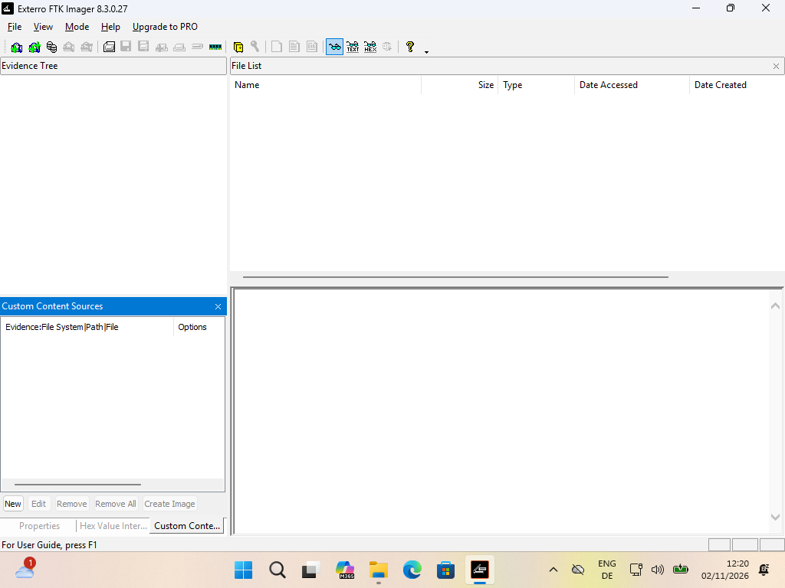
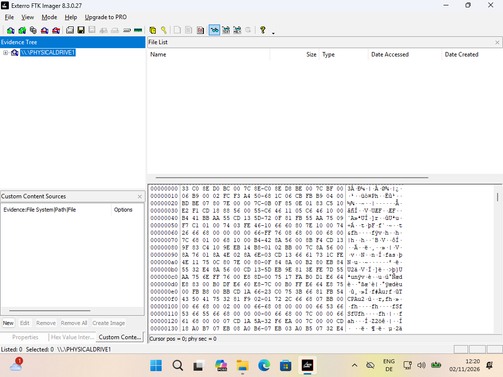
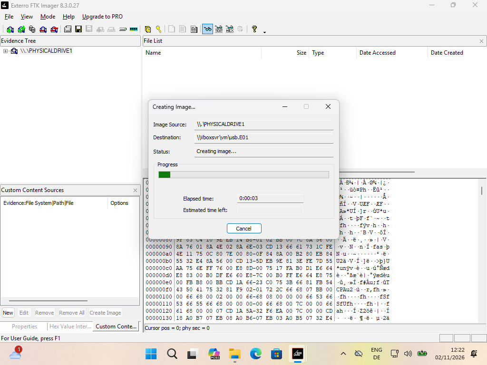
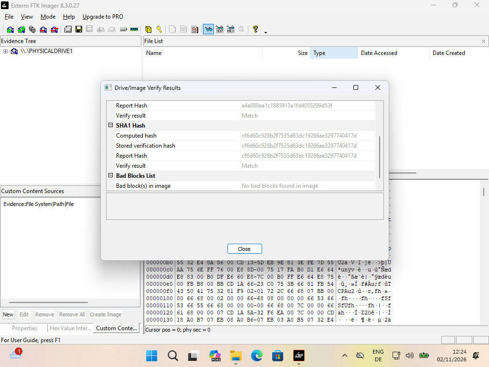

# Forensics exercise

> This scenario is entirely fictional and exists only for teaching. Any resemblance to real people, products or laws is coincidental.

## The case

You are a digital forensics investigator in a country with strict laws against the production, distribution and possession of secret sauces and their recipes. Worcestershire sauce and every other secret sauce are prohibited. Rival illegal sauce operators have been fighting for some time, and much of that fight consists of stealing each other's recipes.

The relevant law reads as follows:

> **Controlled Condiments Act 2019, Section 4 (Prohibited sauces)**
>
> (1) A person commits an offence if they knowingly manufacture, supply, offer to supply, import or possess with intent to supply a controlled condiment.
>
> (2) A "controlled condiment" is any sauce, dressing or marinade whose full list of ingredients or method of preparation is withheld from the public, including but not limited to Worcestershire sauce and any product marketed as containing a "secret recipe".
>
> (3) A person also commits an offence if they obtain, copy or transmit the recipe of a controlled condiment without the consent of the person who holds it.
>
> (4) Possession of a recipe under subsection (3) is presumed to be with intent to supply unless the contrary is shown.

Inspector Murphy seized digital evidence during a search of the home of a suspected secret sauce dealer (case number 4711). The suspect's laptop was destroyed during the search.

### Timeline

- **2 November 2026, about 12:07:** The suspect's home is searched. Officers find a laptop and a USB drive hidden behind a kitchen cabinet. Inspector Murphy dumps the memory of the running Firefox processes from Task Manager while a private browsing window is open. The suspect then later wrestles the laptop from the inspector and throws it into the fireplace, where it is destroyed along with any data on it.
- **2 November 2026, 12:22 to 12:24:** The USB drive is imaged with FTK Imager 8.3 and the image is verified. No other device is imaged.

### Further information

Inspector Murphy took the following screenshots while imaging the USB drive.

FTK Imager open before any evidence was added:



The source drive added as `\\.\PHYSICALDRIVE1`:



Image creation in progress:



Verification results after imaging:



## Evidence

Download the evidence package from the link on Ultra.

The package contains:

| File | Description | SHA-256 |
| --- | --- | --- |
| `USB.E01` | EnCase (E01) image of the 1 GB USB drive (simulated, not encrypted) | `0049179afbed54046d7e6c92768ca3104113b4f25a0241758266df97763409ab` |
| `USB.E01.txt` | FTK Imager log for the USB image | `3d54c42bf8b8b6e6dd84fcf66b24ae2024d83b475f764a2dccb90c06110a030f` |
| `firefox-proc1.DMP` | Task Manager dump of a Firefox process | `de72ad79833919006dcdf4d7c9e625e848d19dba260ef9460bdc97d1a15a7877` |
| `firefox-proc2.DMP` | Task Manager dump of a second Firefox process | `097019d64672bc32ef1504d91b699a28fdef08273047ad94672f0b6945b05f1c` |

Firefox runs several processes, which is why there are two dumps (which might contain overlapping evidence). Nothing else from the laptop survives.

Before you start, check the SHA-256 hashes of your downloaded files against the table above and record the result. The SHA-256 values were computed when the package was put together. FTK Imager recorded these hashes of the USB drive itself at acquisition:

- MD5: `a4a088ea1c1885913a1fd4055299d53f`
- SHA-1: `cf6d60c928b2f7535d63dc19266ae3297740417d`

You can check them against the image with `ewfverify USB.E01` (part of [libewf](https://github.com/libyal/libewf)) or with FTK Imager's "Verify Drive/Image".

## Your task

Build a forensic timeline of the suspect's activities and write a short report on your findings. Keep a full chain of custody and follow good forensic practice throughout. Your report should give a neutral, well-supported opinion on the questions below. At the end of the practical, one or several people will have the opportunity to briefly present your findings.

### The crime

- Which searches and other activities suggest that the suspect was dealing in or procuring secret sauce?
- Is there anything to indicate which types or brands of secret sauce the suspect specialised in?
- Is there any evidence that the suspect was involved in the conflict between sauce operators described above?
- How does the browsing activity in the memory dump compare with what is stored on disk?

### The process

- Are there any irregularities in the evidence that could mean it was fabricated or tampered with?
- What is your professional opinion of the forensic process as a whole, including how the evidence was collected?

## Possible tools

You can use any tools you like. Document which tools you used and be ready to explain why they were appropriate and why they did not alter the evidence.

- [Autopsy](https://www.autopsy.com/) and [The Sleuth Kit](https://www.sleuthkit.org/)
- [Plaso (log2timeline)](https://github.com/log2timeline/plaso), for building a timeline from the disk image, including browser history if you find any
- [DB Browser for SQLite](https://sqlitebrowser.org/), for opening any SQLite databases you recover by hand (open copies, not the originals)
- [bulk_extractor](https://github.com/simsong/bulk_extractor), which pulls URLs, email addresses, search terms and other artefacts out of raw data such as a process memory dump
- [YARA](https://virustotal.github.io/yara/), for searching the dump and disk image with your own patterns
- [WinDbg](https://learn.microsoft.com/en-us/windows-hardware/drivers/debugger/) or the Python [minidump](https://github.com/skelsec/minidump) package, for opening the `.DMP` file and listing its modules, threads and memory regions
- A hex editor such as [ImHex](https://imhex.werwolv.net/), for inspecting the context around anything you find
- Command-line utilities such as `strings` (try `strings -el` as well, since Firefox keeps a lot of text in UTF-16), `grep`, `xxd` and `sha256sum`
- Trial versions of commercial tools, for example [Belkasoft Evidence Center](https://belkasoft.com/)


## Hints

### Building a timeline with Plaso

The easiest way to run Plaso is its Docker image. Put the evidence in one folder (here `~/case4711`) and mount it into the container as `/data`:

```sh
docker pull log2timeline/plaso

# Parse the browser history on every partition of the image into a Plaso storage file
docker run --rm -it -v ~/case4711:/data log2timeline/plaso \
  log2timeline.py --parsers webhist --partitions all --storage-file /data/case.plaso /data/USB.E01

# Export the storage file as a CSV timeline
docker run --rm -it -v ~/case4711:/data log2timeline/plaso \
  psort.py -o dynamic -w /data/timeline.csv /data/case.plaso
```

Depending on your Docker setup you may need `sudo`. `--parsers webhist` only looks at browser artefacts. Drop it to parse everything Plaso understands, which takes longer and produces a much bigger timeline. Open `timeline.csv` in a spreadsheet or in [Timesketch](https://timesketch.org/) and filter it from there.

Plaso writes all timestamps in UTC. Note which time zone each of your other sources uses before you put events from different sources side by side.

### Searching the memory dumps

Run bulk_extractor on each dump and write the results to a separate, empty folder:

```sh
bulk_extractor -o be-proc1 firefox-proc1.DMP
```

Start with `url_searches.txt` and `url_histogram.txt` in the output folder. The first lists search terms found in URLs, with a count of how often each one appears.

### Reading a dump with Python

The [minidump](https://github.com/skelsec/minidump) package can parse the `.DMP` files directly (`pip install minidump`). The script below prints basic process information and the loaded modules, then searches every memory region for a term, both as ASCII and as UTF-16, and shows some text around each hit.

```python
import sys
from minidump.minidumpfile import MinidumpFile

path, term = sys.argv[1], sys.argv[2]
mf = MinidumpFile.parse(path)

print("Process ID:", mf.misc_info.ProcessId)
print("Architecture:", mf.sysinfo.ProcessorArchitecture.name)

print("\nLoaded modules:")
for mod in mf.modules.modules:
    print(f"  {mod.baseaddress:#018x}  {mod.name}")

# Search every memory region for the term, as ASCII and as UTF-16LE
patterns = [term.encode("ascii"), term.encode("utf-16-le")]
print(f"\nHits for {term!r}:")
with open(path, "rb") as f:
    for seg in mf.memory_segments_64.memory_segments:
        f.seek(seg.start_file_address)
        data = f.read(seg.size)
        for pat in patterns:
            pos = data.find(pat)
            while pos != -1:
                context = data[max(0, pos - 40):pos + len(pat) + 80]
                text = context.replace(b"\x00", b"").decode("ascii", "replace")
                print(f"  {seg.start_virtual_address + pos:#018x}  {text!r}")
                pos = data.find(pat, pos + 1)
```

Save it as `dumpinfo.py` and run it with a dump and a search term:

```sh
python dumpinfo.py firefox-proc1.DMP "sauce"
```

The script only opens the dump for reading, but work on a copy anyway and record its hash before and after.

You can also use `strings` or various other tools!
