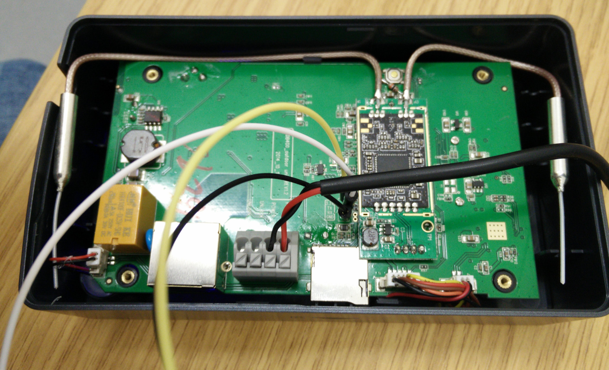

# Analysing an IoT device

## The case

You have been given the firmware of an unknown IoT device. The only thing known is that it runs on an ARM processor. Your job is to take the firmware apart, find out what the device does, and look for security problems.

## Materials

Download the firmware from the link on Ultra. You will also need the ELF binary `/manuf/PPPP_Device` from the firmware. You can extract it yourself in Part 1, or find it in the zip that also contains the whole firmware.

## Your task

### Part 1: Unpacking the firmware and finding the root password

> **Spoiler warning:** the section "About the device" at the very end of this page names the device. Don't scroll that far until you have finished Part 2.

- Give the SHA-1 hash of the firmware you downloaded, so you can later check that you worked on the right file.
- Write a shell script that unpacks the firmware and prints the root password hash. The script should assume the firmware is called `firmware_for_task.bin` and sits in the same folder as the script. The script's output should be a single line of the form `root:<HASH>`, where `<HASH>` is the password hash from `/etc/shadow`.
- Crack the root password hash and give the password in clear text. You can use John the Ripper, hashcat or an online service. 

### Warning: unpacking CPIO archives safely

The root file system inside the firmware is a CPIO archive and every file in it is stored with an absolute path, such as `/etc/shadow` or `/lib/libc.so.6`. If `cpio` is run with the wrong options, it writes those files to the same paths on **your own machine**. When run as root, this overwrites your system's password file and libraries, and your machine may not boot again. Some `cpio` versions keep absolute paths by default, so do not rely on the defaults.

Follow these rules:

- **Never run `cpio` (or your unpacking script) as root or with `sudo`.** As a normal user, a mistake fails with "Permission denied" instead of overwriting system files. You don't need root to unpack the archive: the only things that fail are device nodes such as `/dev/console`, and you can ignore those errors.
- **List the archive before you extract it** and check where the files would go:

  ```sh
  cpio -itv < rootfs.cpio | head
  ```

- **Extract into a new, empty folder and always pass `--no-absolute-filenames`**, which makes `cpio` strip the leading `/` and create everything under the current folder:

  ```sh
  mkdir rootfs
  cd rootfs
  cpio -idv --no-absolute-filenames < ../rootfs.cpio
  ```

- **Never pass `--absolute-filenames`** and don't use a different `cpio` implementation (such as BusyBox or BSD `cpio`) without checking how it handles absolute paths.
- **Work in a virtual machine or container if you can** so that a mistake can only damage something you can throw away.
- **Keep binwalk up to date.** Older versions of binwalk's extraction (`binwalk -e`) had a path traversal bug (CVE-2022-4510) that let a crafted firmware write files outside the extraction folder.

### Part 2: Analysing a service on the device

Much of the device's functionality is in the ELF binary `/manuf/PPPP_Device`. You can load it into a disassembler such as Ghidra or IDA (or just ARM `objdump`). It is a 32-bit ARM executable.

- Based on this binary, what do you think the device does? 
- The binary contains, among other things, a hard-coded IP address of the manufacturer's online backend. What is this address, and which hosting provider does the manufacturer use?
- The device's DNS resolver is set up to use specific name servers. Give their IP addresses. In which country are they located?

The binary also talks to an I2C device for "copy protection" outside the main CPU and runs a cryptographic handshake with it. This is implemented in the function at `0xE430` (with the image base at `0x8000`). We will call this function `encry_check()`. It prints "AUTH FAILED" if the authentication fails and "AUTH PASS" if it succeeds.

For the following questions, **do not** try to reverse-engineer every instruction, as that would take too long. You can assume that the code was not written to deceive someone reversing it.

- `encry_check()` first allocates several buffers and loads a "magic" 16-byte buffer, which could for example be a cryptographic key. At which address is this buffer, and what is its value?
- Find the function call inside `encry_check()` that most likely invokes the underlying cryptographic algorithm. Give the address of the function you think implements the crypto.
- Which cryptographic algorithm do you think is used, and why? To make this easier, below is the output of [Signsrch](https://github.com/pierrezurek/Signsrch) run on `PPPP_Device`. It finds several "magic" crypto constants, including DES, AES and Noekeon. The offsets are file offsets from 0, and the file is mapped to `0x8000` in Ghidra or IDA, so add `0x8000` to each offset to find the address in your disassembler.

```
offset   num  description [bits.endian.size]
--------------------------------------------
0000009a 2417 MBC2 [32.le.248&]
0000009d 2418 MBC2 [32.be.248&]
0004f198 843  ima_adpcm step table [32.le.356]
0005815c 2080 RawDES sbox1 [32.le.256]
0005825c 2082 RawDES sbox2 [32.le.256]
0005835c 2084 RawDES sbox3 [32.le.256]
0005845c 2086 RawDES sbox4 [32.le.256]
0005855c 2088 RawDES sbox5 [32.le.256]
0005865c 2090 RawDES sbox6 [32.le.256]
0005875c 2092 RawDES sbox7 [32.le.256]
0005885c 2094 RawDES sbox8 [32.le.256]
0005895c 1925 libntlm DES key_swap [32.le.64]
0005899c 1926 libntlm DES key_swap [32.be.64]
0005d750 1902 Speex high_lsp_cdbk [..512]
0005d950 1903 Speex high_lsp_cdbk2 [..512]
0005e130 1901 Speex exc_5_256_table [..1280]
0005e7f0 1900 Speex lsp tables nb cdbk_nb [..640]
00063638 839  ADPCM index table (step variation) [32.le.64]
000636c9 914  Rijndael rcon [32.le.40]
000636cc 915  Rijndael rcon [32.be.40]
000636e5 2414 Noekeon Nessie round [32.be.68]
000636e8 2413 Noekeon Nessie round [32.le.68]
000642c8 1460 libaf alaw_decode [16.le.256]
```

### Part 3: Further analysis

Describe one other thing about this firmware that you find insecure or remarkable. It could be an insecure configuration setting, an insecure binary, a backdoor, bad design practice or something else. Write about 50 words.

## Possible tools

Your script in Part 1 can e.g. use:

- [binwalk](https://github.com/ReFirmLabs/binwalk)
- [easylzma](https://github.com/lloyd/easylzma) (`elzma` and `unelzma`)
- `unzip` and `cpio`
- other standard tools such as `dd`, `tar`, `gzip`, `bzip2` and `strings`

For the rest of the exercise you can use any tools you like, for example:

- [Ghidra](https://ghidra-sre.org/) or [IDA Free](https://hex-rays.com/ida-free), for disassembling and decompiling `PPPP_Device`
- [John the Ripper](https://www.openwall.com/john/) or [hashcat](https://hashcat.net/hashcat/), for cracking the password hash
- [Signsrch](https://github.com/pierrezurek/Signsrch), for finding crypto constants
- A hex editor such as [ImHex](https://imhex.werwolv.net/)

## About the device

**Spoiler:** only read this after you have answered the Part 2 question about what the device does.

The firmware comes from a Smart-I Smartbell Plus, a Wi-Fi video doorbell with a camera, a speaker, an optional door release and a phone app. It was read from the device's SPI flash through the U-Boot bootloader on the serial console. How that was done is described in [iot-fw-extraction/smarti](https://github.com/david-oswald/iot-fw-extraction/tree/master/smarti).

The photo below shows the opened device with wires soldered to the serial console pads (labelled TX, RX and GND on the board). The relay on the left drives the door release.


